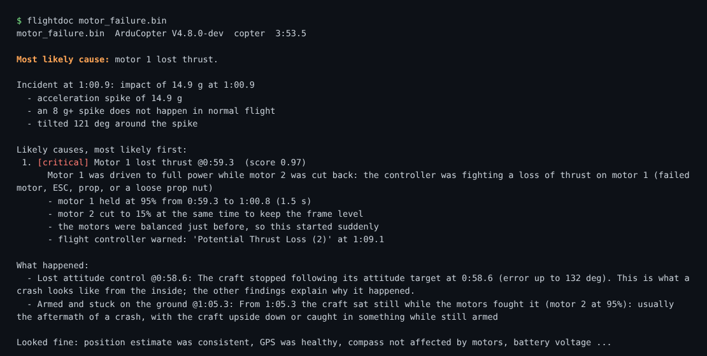
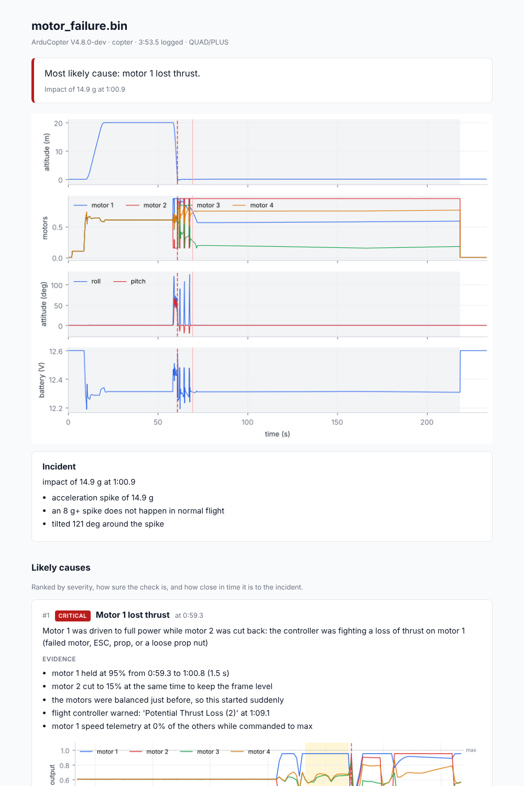
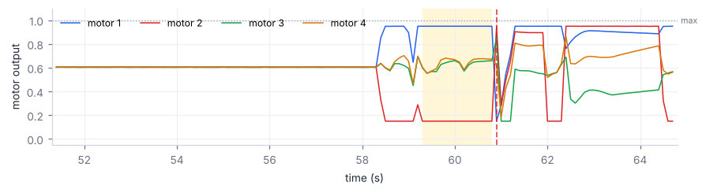
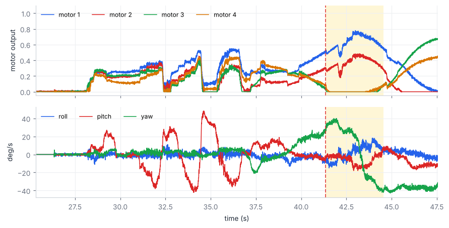
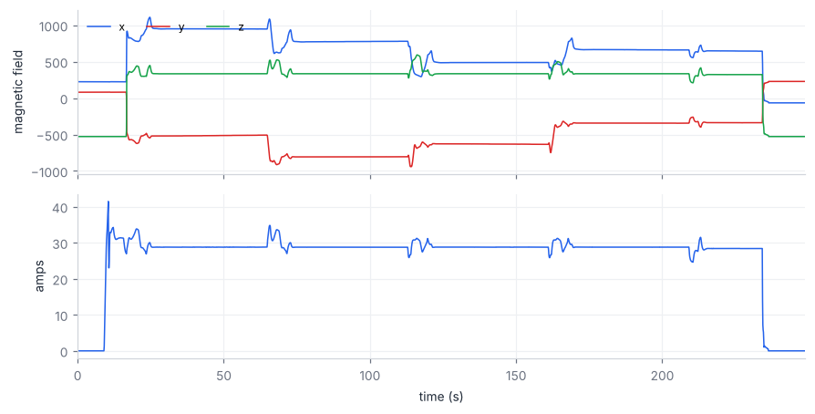
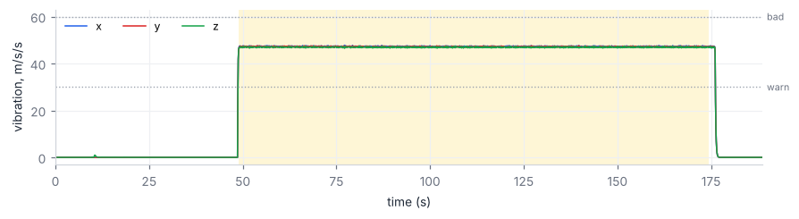

# flightdoc

**Find out why your drone crashed.** Point it at a flight log and it tells you what went wrong, when, and what to check, instead of leaving you to scroll through forty graphs.

**[Try it in your browser](https://colaco1123.github.io/flightdoc/)**: drop a log on the page, nothing to install. The analysis runs locally in the tab (Python via WebAssembly), so your log is never uploaded.

Or install the command line tool:

```
pip install git+https://github.com/colaco1123/flightdoc
flightdoc 00000042.BIN -o report.html
```

Works with **ArduPilot** (`.bin`), **PX4** (`.ulg`), **Betaflight** and its forks (`.bbl`, `.bfl`), and **INAV** (`.txt`, `.bbl`). Gzipped logs and `blackbox_decode` CSVs work too.

<p align="center"></p>

## Why

Every week the ArduPilot, PX4 and FPV forums get the same post: *"it just fell out of the sky, here is my log, what happened?"* The existing tools ([UAV Log Viewer](https://github.com/ArduPilot/UAVLogViewer), [PX4 Flight Review](https://github.com/PX4/flight_review), [Betaflight Blackbox Explorer](https://github.com/betaflight/blackbox-log-viewer)) are good at plotting a log. They do not tell you which of the forty plots matters. Someone experienced still has to look at it and say "motor 3 is pinned at 100% while motor 4 is cut to idle, that's a dead ESC".

flightdoc does that step. It finds the moment things went wrong, runs a set of checks that each know one failure mode, and ranks the results by how severe they are, how sure the check is, and how close they are in time to the incident.

## What the report looks like

`flightdoc LOG -o report.html` writes a single self-contained HTML file (plots embedded) that you can attach to a forum post or send to whoever built the craft.

<p align="center"></p>

Example reports from the test logs are in [`examples/`](examples).

## What it detects

| Check | What it looks for | Firmware |
|---|---|---|
| Motor failure | One motor pinned at max while the opposite one is cut, the signature of a dead motor, ESC or prop | all multirotors |
| Take-off problems | Motors wildly unequal while the craft barely moves: wrong motor order, wrong direction, props swapped | all multirotors |
| ESC desync | Motor commanded hard while its RPM telemetry collapses | BF (bidir DShot), AP (ESC telemetry) |
| Thrust headroom | Hover throttle too high, all motors saturated together | all |
| Motor balance | One motor working harder in calm flight: CG offset, weak motor, twisted mounts | all multirotors |
| Vibration | VIBE levels and accelerometer clipping (ArduPilot thresholds) | AP, PX4 |
| Gyro noise | High-frequency noise reaching the PID loop, with the dominant frequency | BF, INAV, PX4 |
| Oscillation | Narrow-band oscillation in the rate tracking error that the pilot did not command | all |
| Attitude control | Large sustained gap between target and actual attitude | all |
| Battery | Cell count, sag under load, pack resistance, voltage at the incident, battery failsafes | all |
| Board power | Flight controller supply rail dips (brownout risk) | AP, PX4 |
| Power loss | Log stops mid-air with the motors running (and tells this apart from a full flash chip) | all |
| EKF | Innovation test ratios, and which sensor the estimator rejected | AP, PX4 |
| GPS | Satellite count, HDOP, fix loss, position jumps, receiver dropouts | all with GPS |
| Compass | Magnetometer reading that moves with current or throttle (motor interference) | all with a compass |
| Radio | RC link loss, RSSI, failsafe phases | all |
| CPU | Overloaded scheduler / long loops | AP, PX4 |

When two findings explain each other, the root cause gets the credit: if the EKF rejected the compass *and* the compass moves with current, compass interference ranks first and the EKF finding says it is a consequence.

<table>
<tr>
<td width="50%"><br><sub><b>Motor failure.</b> Motor 1 goes to 95% and motor 2 to 15% half a second before the 14.9 g impact.</sub></td>
<td width="50%"><br><sub><b>Could not take off.</b> A real EmuFlight log: motor 1 climbs to 75% while 3 and 4 sit at idle and the gyro hardly moves.</sub></td>
</tr>
<tr>
<td><br><sub><b>Compass interference.</b> The field jumps by more than the earth's field the moment current flows.</sub></td>
<td><br><sub><b>Vibration.</b> VIBE well above ArduPilot's 30 m/s/s line after the frame starts shaking.</sub></td>
</tr>
</table>

## How it works

1. **Load.** Each format is turned into the same firmware-independent `Flight`: attitude, rates, motors, battery, GPS, EKF ratios, events, armed spans. The checks never see a raw log, so a check written once works on every firmware that logs the signals it needs.
2. **Find the incident.** In order of trust: the flight controller saying so (ArduPilot crash check, Betaflight crash protection, PX4 failure detector), an acceleration spike with a second confirming sign, the craft tipping past 75° and staying there, the craft stopping while the motors keep fighting, or the log simply stopping with the motors running. Freestyle quads pull 5 g on purpose, so Betaflight and INAV logs need stronger confirmation.
3. **Run the checks.** Each check returns findings with a severity, a confidence, the time span, the evidence (numbers from the log, not adjectives), what to check, and links to the relevant firmware docs.
4. **Rank.** Score = severity × confidence × relevance, where relevance is high when the problem starts in the twenty seconds before the incident and low when it shows up after (a consequence, not a cause).

The decoders are written from the format specifications, with no firmware tooling needed:

- **DataFlash** (ArduPilot): one pass to index messages, then numpy pulls each message type out in bulk. Cross-checked against [pymavlink](https://github.com/ArduPilot/pymavlink).
- **Blackbox** (Betaflight, INAV, EmuFlight, Cleanflight): a pure-Python implementation of the frame format (all predictors and encodings, including the tagged group encodings and Elias codes). Decoded values match the reference `blackbox_decode` exactly on every real test log. It also handles two things the reference decoder gets wrong: Betaflight 4.x's `P interval:8` header style, and INAV's flight-mode event, which the INAV fork of the tool does not know and therefore drops the frames that follow.
- **ULog** (PX4): read with [pyulog](https://github.com/PX4/pyulog), with handling for topics and fields that were renamed between releases.

## Validation

The test suite runs every check against logs with a single known fault.

| Log | Source | Injected fault | flightdoc says |
|---|---|---|---|
| `motor_failure.bin` | ArduCopter SITL | motor 1 thrust set to 0 in a hover | Motor 1 lost thrust |
| `high_vibration.bin` | ArduCopter SITL | 70 m/s/s accelerometer vibration | High vibration |
| `compass_interference.bin` | ArduCopter SITL | motor-current magnetic field | Compass interference (EKF mag rejection credited to it) |
| `gps_glitch.bin` | ArduCopter SITL | 65 m GPS position glitch | GPS problems |
| `radio_failsafe.bin` | ArduCopter SITL | RC link cut | Radio link lost |
| `power_loss.bin` | ArduCopter SITL | battery sag, then process killed | Battery ran low, then power lost in flight |
| `healthy.bin` | ArduCopter SITL | none | No problems |
| `px4_gps_loss.ulg` | PX4 SIH | GPS receiver off | GPS problems |
| `px4_battery_drain.ulg` | PX4 SIH | fast battery drain | Battery failsafe triggered |
| `px4_healthy.ulg` | PX4 SIH | none | No problems |
| `crashing-LOG00002.BFL` | real EmuFlight flight | (unknown) | Could not take off level |
| `LOG00037.BFL`, `btfl_001.bbl` | real Betaflight 4.2 flights | none | No false alarms |
| `LOG00004.TXT` | real INAV 3.0 plane, 16 MiB flash dump | none | No false alarm: the abrupt end is recognised as a full flash chip |
| `LOG00004.TXT`, first 3 MB only | same, cut short for the test suite | file cut mid-flight | Power was lost in flight (correct for a cut file) |

The SITL logs can be regenerated with [`tools/sitl_scenarios.py`](tools/sitl_scenarios.py) (ArduPilot) and [`tools/px4_sih_scenarios.py`](tools/px4_sih_scenarios.py) (PX4), then shrunk with [`tools/trim_log.py`](tools/trim_log.py).

```
pip install -e ".[dev]"
pytest
```

## Limitations

Be honest with yourself about what a log can show.

- Simulated faults are cleaner than real ones. The thresholds were then checked against real Betaflight and INAV flights for false alarms, but more real crash logs are the best way to make this better (see below).
- PX4's SIH simulator ignores injected motor failures, so the PX4 motor-failure path is only tested through the shared check code and ArduPilot logs.
- Betaflight logs the accelerometer after heavy filtering, so impacts read lower than they were and vibration is judged from the gyro instead.
- No log, no diagnosis: if the battery came off on impact, the last thing logged is all there is.
- Thresholds come from firmware documentation and experience, not from a large labelled dataset. Treat the ranking as a strong first guess, then confirm it on the craft.

## Using it from Python

```python
from flightdoc import analyze

for d in analyze("flight.ulg"):
    print(d.verdict)
    for cause in d.causes[:3]:
        print(cause.severity, cause.title, cause.t0, cause.evidence)
```

`d.to_dict()` gives the same content as `--json`.

## The web version

[`web/`](web) is a static page that runs the same package in the browser with [Pyodide](https://pyodide.org). A worker loads Python, numpy, pandas, scipy and matplotlib from the Pyodide CDN, installs the flightdoc and pyulog wheels served next to the page, and renders the same HTML report. The [`web app`](.github/workflows/pages.yml) workflow rebuilds and deploys it to GitHub Pages on every push. To run it locally:

```
python web/build_site.py site
python -m http.server -d site 8000
```

## Help it get better

If flightdoc gets your crash wrong, open an issue with the log (or a link to it) and what actually happened. Logs with a known cause are the most useful thing you can contribute: each one becomes a test.

## References

Projects this builds on or was checked against:

- [ArduPilot](https://github.com/ArduPilot/ardupilot): DataFlash format, SITL used for the fault scenarios, and the vibration, EKF, compass and thrust-loss guidance in the [Copter docs](https://ardupilot.org/copter/docs/common-diagnosing-problems-using-logs.html)
- [Pyodide](https://github.com/pyodide/pyodide): runs the web version in the browser
- [PX4 Autopilot](https://github.com/PX4/PX4-Autopilot): ULog format, SIH simulator used for the PX4 scenarios, [log analysis docs](https://docs.px4.io/main/en/log/flight_log_analysis.html)
- [pyulog](https://github.com/PX4/pyulog): ULog parsing (dependency)
- [pymavlink](https://github.com/ArduPilot/pymavlink): used in the tests to cross-check the DataFlash reader, and by the SITL scripts
- [Betaflight blackbox-tools](https://github.com/betaflight/blackbox-tools) and the [INAV fork](https://github.com/iNavFlight/blackbox-tools): reference `blackbox_decode`, used as the oracle for the blackbox decoder tests; the format is described in Betaflight's [Blackbox internals](https://www.betaflight.com/docs/development/Blackbox-Internals)
- [Betaflight Blackbox Explorer](https://github.com/betaflight/blackbox-log-viewer): header conventions such as `P interval`
- [fc-blackbox](https://github.com/ilya-epifanov/fc-blackbox): source of the real Betaflight, EmuFlight and INAV test logs (MIT/Apache-2.0, see [`tests/data/blackbox`](tests/data/blackbox))
- [UAV Log Viewer](https://github.com/ArduPilot/UAVLogViewer), [PX4 Flight Review](https://github.com/PX4/flight_review), [PID-Analyzer](https://github.com/Plasmatree/PID-Analyzer): the plotting and tuning tools this is meant to sit next to
- [parallax-blackbox-analyzer](https://github.com/colaco1123/parallax-blackbox-analyzer): my INAV blackbox viewer; flightdoc is the diagnosis layer that the viewer did not have

## License

MIT. The test logs under `tests/data/blackbox` keep their original MIT/Apache-2.0 license.
